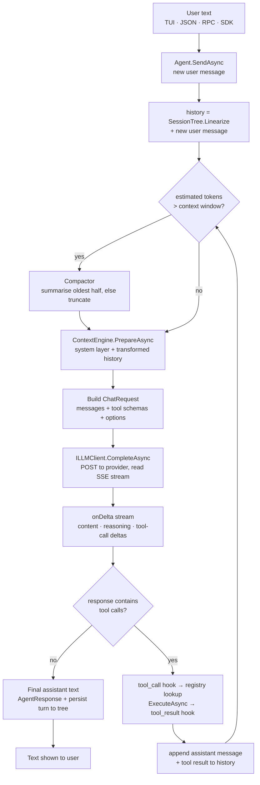
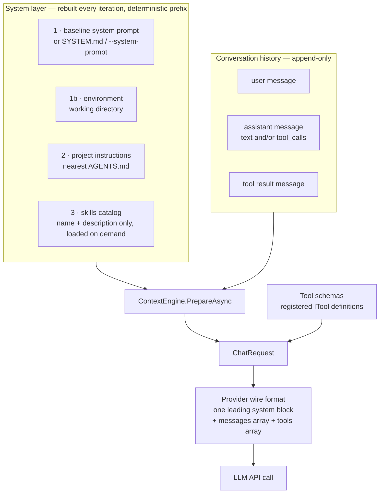
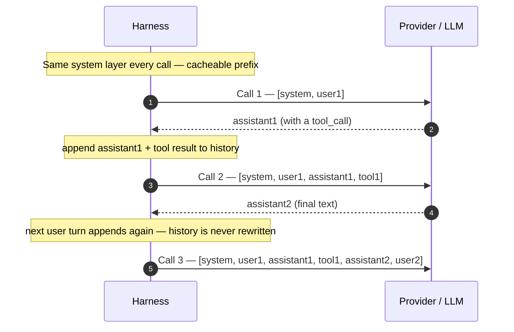
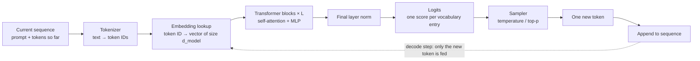
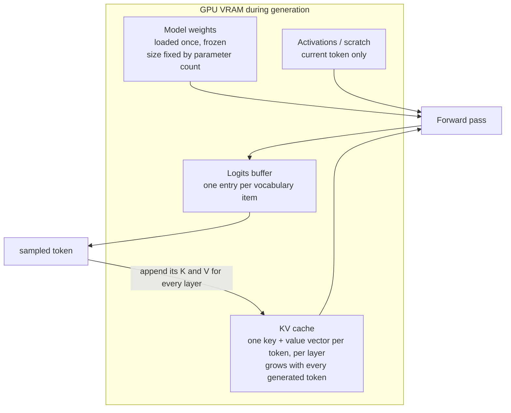

# How the Noah LLM Harness Works

A visual explanation of the harness in `irl-harness` (`src/Noah.Core`, `src/Noah.LLM`),
covering three things:

1. **The harness loop** — text in, text out, with tools in between.
2. **Prompt assembly** — what actually gets sent to the model each call, and how
   each prompt is the previous prompt plus whatever was appended.
3. **Per-token generation on the GPU** — how the prompt populates VRAM, flows
   through the transformer for every token, and how the KV cache grows.

> **Two loops, don't conflate them.** The *outer* loop is the harness: it makes
> one API call per model turn and resends the whole prompt each time. The *inner*
> loop is the provider's GPU: it runs one forward pass per output token and only
> feeds the newest token, because everything before it is held in the KV cache.

---

## 1. The harness loop — text in, text out

The harness is a thin streaming wrapper. The model only ever sees text (and tool
schemas); it only ever produces text (and tool-call requests). Everything else —
files, shells, compilation — happens because a tool result is turned back into
text and appended to the next prompt.

Key properties (see `src/Noah.Core/Agent/Agent.cs`):

- The loop repeats until the model answers **without** tool calls, bounded by
  `MaxIterations` (`Agent.cs:261`).
- Tools **never throw to the model** — failures become readable `ToolResult`
  text the model can recover from (`Agent.cs:429-438`).
- Output is streamed token-by-token through the single `onDelta` boundary
  (`src/Noah.Sdk/LLM/ILLMClient.cs:31`); providers only translate wire formats.

---

## 2. Prompt assembly — each prompt is the last one plus new messages

Every API call rebuilds the same layered system prefix and appends the growing
conversation. The prefix is deterministic, so providers can cache it (see
`ARCHITECTURE.md:120`).

What "each subsequent prompt is a copy of the last with the new prompt appended"
looks like in practice (`ContextEngine.cs:89`, `ChatCompletionsClient.cs:62`):

- History is only ever **appended to**; the model is stateless between calls.
- When history nears the window, a compactor replaces the **oldest** messages
  with a summary (`ContextEngine.cs:106`), which is the one time the prefix
  changes.
- The harness estimates tokens cheaply as `chars / 4` plus per-message overhead
  (`TokenEstimator.cs:11`).

---

## 3. Per-token generation on the GPU

Once the prompt reaches the provider, the GPU generates one token at a time.
Each token is one full pass through the network; the sequence on the GPU grows
by exactly one each step.

### 3a. One forward pass = one token

### 3b. What lives in GPU RAM

- **Prefill** (first pass) processes the whole prompt at once and fills the KV
  cache with one entry per prompt token.
- **Decode** (every token after) feeds only the newest token; attention reads
  the cached K/V of all earlier tokens instead of recomputing them.
- That is why cost per token is roughly flat while the KV cache — and therefore
  VRAM — grows linearly with sequence length.

### 3c. The sequence grows by one token per step

| Step | What is fed to the GPU this pass | Sequence length | KV-cache rows | Sampled |
| --- | --- | --- | --- | --- |
| Prefill | all prompt tokens at once | N | N | token 1 |
| Decode 1 | token 1 only | N+1 | N+1 | token 2 |
| Decode 2 | token 2 only | N+2 | N+2 | token 3 |
| Decode 3 | token 3 only | N+3 | N+3 | token 4 |

### 3d. How this relates to the harness's growing prompt

The harness sends a **new, longer prompt on each API call** (Diagram 2). The
provider does not recompute the shared prefix from scratch: because the prefix
is byte-identical, its KV cache is reused and only the newly appended suffix is
processed (prompt/prefix caching). So the two "copy and append" behaviours line
up:

- Harness: `prompt(n+1) = prompt(n) + new messages`.
- GPU: `sequence(n+1) = sequence(n) + one token`, with the old prefix's K/V
  reused.

---

## Source map

| Concept | Location |
| --- | --- |
| Agent loop, iteration cap, tool execution, append | `src/Noah.Core/Agent/Agent.cs:242`, `:261`, `:391`, `:446` |
| Streaming boundary / `ChatRequest` | `src/Noah.Sdk/LLM/ILLMClient.cs:6`, `:31` |
| Layered system prompt | `src/Noah.Core/Context/ContextEngine.cs:48` |
| Context assembly + compaction | `src/Noah.Core/Context/ContextEngine.cs:89`, `:106` |
| Token estimate (`chars / 4`) | `src/Noah.Core/Context/TokenEstimator.cs:11` |
| Provider wire format + SSE parse | `src/Noah.LLM/Providers/ChatCompletionsClient.cs:62`, `:159` |
| Provider-neutral message model | `src/Noah.Sdk/Models/ChatMessage.cs:21` |
| Prompt caching rationale | `ARCHITECTURE.md:120` |
